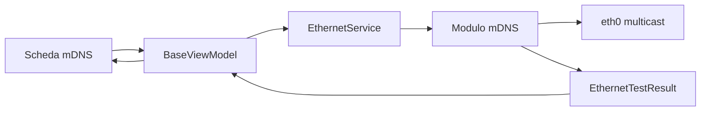

# Requisiti

### Obiettivo
Aggiungere una nona scheda **mDNS**, con ricerca attiva DNS-SD integrata nell’app, senza Avahi o nuovi demoni.

- Invio avvia o annulla una ricerca di 10 secondi su `eth0`; nessuna ricerca automatica.
- Mostrare servizi annunciati: istanza, tipo (`_ipp._tcp`, `_ssh._tcp`, ecc.), hostname, porta e indirizzi disponibili. Metadati TXT leggibili, con limiti espliciti.
- Conteggio a tutta larghezza e blocchi di risultati scorrevoli, mantenendo tema scuro, descrizione full width, frecce e `F`/`X`.
- Nell’area mDNS mostrare un elenco semplice e selezionabile; Su/Giù spostano la selezione, `Tab` apre il dettaglio e `Esc`/Backspace torna all’elenco.
- Posizionare la scheda mDNS immediatamente dopo Peers (Discovery/ARP), prima di Driver.
- Nessun limite arbitrario alle prime cinque voci: limiti di memoria, query e risultati dichiarati; eventuale elenco parziale segnalato chiaramente.
- Nessun risultato non equivale a rete guasta: mDNS non rivela dispositivi silenziosi, altre VLAN o tutti i servizi esistenti.
- Primo supporto con trasporto multicast IPv4; mostrare anche indirizzi IPv6 ricevuti nei record AAAA, senza promettere scoperta su reti solo IPv6.

# Design tecnico

### Integrazione esistente
`EthernetService` instrada già DNS e Switch verso funzioni cancellabili in `ethernet_diagnostics.*`. `BaseViewModel` pubblica i risultati sul thread LVGL; `AppleScreen` gestisce schede orizzontali e dettagli scorrevoli. Conservare questo percorso senza aggiornare LVGL dal worker.

### Ricerca
Implementare un modulo dedicato con socket UDP multicast su `224.0.0.251:5353`, selezione esplicita di `eth0` per invio e ricezione e TTL multicast 255. Gestire la coesistenza con un eventuale responder locale sulla porta 5353; errori di binding o permessi devono essere espliciti, senza arrestare altri servizi o aggiungere privilegi.

Interrogare `_services._dns-sd._udp.local.`, poi i tipi scoperti e le relative istanze. Correlare record PTR, SRV, TXT, A e AAAA anche se arrivano fuori ordine o nelle sezioni aggiuntive; inviare richieste mirate solo per informazioni mancanti. Non contattare i servizi scoperti.

Usare deadline unica di 10 secondi, attese brevi cancellabili, deduplicazione e budget finiti per query, pacchetti e memoria. Gestire TTL zero, record scaduti e bit cache-flush. Campi mancanti restano indicati come non risolti; raggiungimento dei budget o risposte troncate producono un avviso di ricerca incompleta, non un successo completo.

### Parser e risultati
Parser puro, testabile senza socket, con controlli su lunghezze, conteggi, compressione DNS e cicli nei puntatori. Riutilizzare le convenzioni del parser DNS esistente, senza modificarne il contratto unicast per adattarlo a mDNS. Sanitizzare nomi e TXT prima della visualizzazione.

Il riepilogo indica numero di istanze e durata. Ogni servizio ha una testatina full width e righe etichetta/valore; ordinamento stabile per tipo e istanza. Evitare che i due punti degli indirizzi IPv6 vengano interpretati come separatori aggiuntivi dal renderer.

### File interessati
- Nuovi `src/platform/ethernet_mdns.h` e `.cpp`: parser, aggregazione DNS-SD e ricerca cancellabile; funzione pubblica `browse_mdns(const std::atomic<bool>&)` che restituisce `EthernetTestResult`.
- `src/platform/ethernet_service.cpp`: instradamento della nuova diagnostica.
- `src/model/ethernet_model.h`: categoria `Mdns` immediatamente dopo `Discovery` e conteggio nove.
- `src/viewmodel/base_viewmodel.cpp`: nome e descrizione inglesi, senza invito di avvio ridondante.
- `src/view/screens/apple_screen.cpp`: etichetta mDNS; riuso dei dettagli esistenti, adattando il rendering solo se necessario.
- `CMakeLists.txt`: collegamento modulo e nuovo `tests/ethernet_mdns_test.cpp`.
- `tests/ethernet_navigation_test.cpp` e `tests/ethernet_screen_test.cpp`: nuova ultima scheda, navigazione e risultati lunghi.
- `README.md`: modalità, limiti e traffico generato. Nessuna nuova dipendenza di pacchetto.

### Flusso

# Verifiche

### Test automatici senza rete
- Pacchetti sintetici con PTR, SRV, TXT, A e AAAA, nomi compressi, record aggiuntivi e risposte suddivise o fuori ordine.
- Deduplicazione, TTL zero, scadenza, cache-flush, dati mancanti e nomi/metadati non sicuri per la UI.
- Pacchetti troncati, puntatori ciclici o fuori buffer, limiti risorse e cancellazione tramite trasporto/orologio sostituibili nei test.
- Navigazione circolare su nove schede, mDNS visibile automaticamente nella barra, conteggio full width e scroll avanti/indietro con molti risultati.

### Build
Build desktop e CTest; avvio del simulatore senza iniziare diagnostiche. Build ARM64 se toolchain e sysroot sono disponibili, più `git diff --check`. Nessuna scansione sulla rete di sviluppo, installazione o deploy; la compatibilità multicast su hardware resta da verificare separatamente.

# Delivery Steps

### ✓ Step 1: Implementare parser e aggregazione DNS-SD
Il modulo mDNS interpreta e raggruppa servizi da pacchetti sintetici senza accesso alla rete.
- Aggiungere `ethernet_mdns.*` e collegarlo in `CMakeLists.txt`.
- Implementare parsing difensivo PTR/SRV/TXT/A/AAAA e correlazione di istanze, host e indirizzi.
- Gestire deduplicazione, TTL, cache-flush e budget di memoria.
- Aggiungere `ethernet_mdns_test.cpp` con casi validi, incompleti e malformati.

### ✓ Step 2: Aggiungere la ricerca multicast cancellabile
Il servizio può eseguire una ricerca DNS-SD limitata su eth0 e restituire risultati espliciti.
- Implementare socket multicast, selezione interfaccia e query progressive con deadline di 10 secondi.
- Limitare traffico e risorse; gestire annullamento, porta occupata, permessi e ricerca parziale.
- Collegare la categoria `Mdns` al dispatch in `ethernet_service.cpp` e produrre dettagli leggibili.
- Verificare timeout, cancellazione e query tramite trasporto e tempo controllati nei test, senza rete reale.

### ✓ Step 3: Integrare la scheda mDNS nell’interfaccia
La scheda mDNS, subito dopo Peers, mostra servizi e dettagli scorrevoli con gli stessi comandi delle diagnostiche esistenti.
- Aggiornare conteggio categorie, nome/descrizione nel ViewModel e barra in `apple_screen.cpp` mantenendo mDNS accanto a Peers.
- Presentare riepilogo full width e blocchi servizio, gestendo campi lunghi, TXT e IPv6.
- Estendere test di navigazione e schermata per la nuova ultima scheda e risultati numerosi.
- Documentare comportamento e limiti nel README; eseguire build desktop, CTest, simulatore senza diagnostiche e cross-build se disponibile.

### x Step 4: Aggiungere elenco mDNS selezionabile e dettaglio
La scheda mDNS presenta prima l’elenco dei servizi; un’azione apre il dettaglio selezionato e Back torna all’elenco.
- Separare riepilogo/avvisi dai blocchi servizio già prodotti e renderizzare righe selezionabili.
- Usare Su/Giù per selezionare in elenco, `Tab` per aprire i dettagli e `Esc`/Backspace per tornare.
- Aggiornare help e README e testare lista, selezione, dettaglio, ritorno e scrolling.

### ✓ Step 4: Aggiungere elenco mDNS selezionabile e dettaglio
La scheda mDNS mostra un elenco compatto navigabile e apre i dettagli del servizio selezionato.
- Separare i blocchi di servizio già prodotti in una lista e una vista di dettaglio, preservando conteggio e avvisi.
- Instradare frecce, `Tab` e `Back` solo nella scheda mDNS; mantenere selezione e scroll appropriati.
- Aggiungere test UI per selezione, dettaglio, ritorno e contenuti lunghi; aggiornare help e README.
- Eseguire build desktop, CTest, build ARM64 se disponibile e `git diff --check`; nessuna ricerca di rete.

### ✓ Step 5: Aggiungere risultati di campo e diagnostica passiva
Estendere il modello senza rimuovere categorie esistenti; aggiungere lettura lease in sola lettura e parser dell'ascolto passivo.
- Conservare risultati e timestamp per categoria e rappresentare esplicitamente lo stato non testato.
- Aggiungere lettura del lease systemd-networkd senza inviare DHCP o riconfigurare la rete.
- Aggiungere parser/aggregazione limitata per ARP, DHCP e STP, senza cattura PCAP.
- Aggiungere test sintetici per lease, frame e aggregazione degli stati.

### ✓ Step 6: Aggiungere riepilogo e Auto Test esplicito
Mostrare tre stati di salute con età del dato e consentire una sequenza manuale cancellabile.
- Aggiungere riepilogo Link, IP/DNS e ascolto con GREEN/YELLOW/RED/NOT TESTED.
- Eseguire solo su richiesta Link, Setup, Ping, DNS e Switch in sequenza; mantenere annullamento e risultati separati.
- Invalidare prudentemente il riepilogo quando viene osservata una variazione del carrier.

### ✓ Step 7: Integrare le nuove viste e verificare
Aggiungere Summary, DHCP e Listen mantenendo tutte le schede e il browser mDNS.
- Aggiornare navigazione, schermate e help senza rimuovere le diagnostiche esistenti.
- Documentare limiti, assenza di DHCP attivo e gestori lease non supportati nel README.
- Eseguire build desktop, CTest, simulatore senza diagnostiche, build ARM64 se disponibile e `git diff --check`.

### ✓ Step 8: Ripristinare la selezione visibile nella lista mDNS
Tornando dal dettaglio, mantenere selezionato e visibile il servizio aperto.
- Dopo il layout della lista, scorrere fino alla riga selezionata; mantenere scroll iniziale se non ci sono servizi.
- Estendere il test UI per verificare scroll, visibilità, selezione e riapertura dello stesso servizio.
- Eseguire build desktop, CTest e `git diff --check` senza diagnostiche di rete.